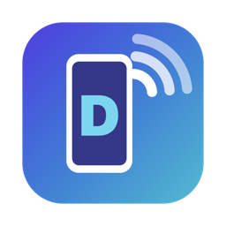
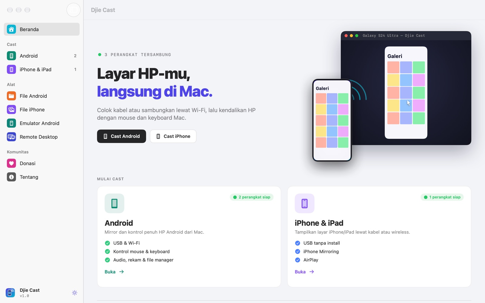
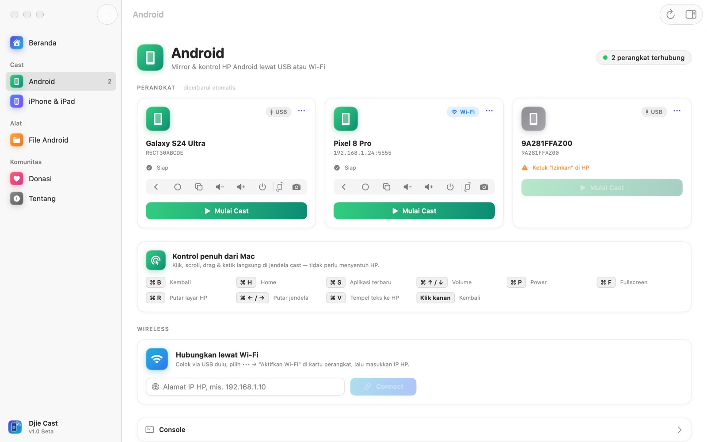
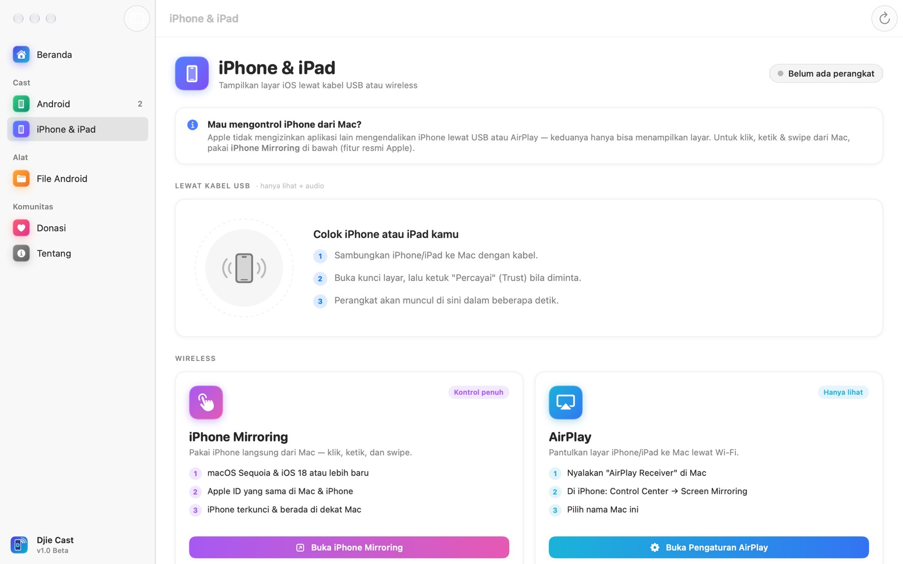
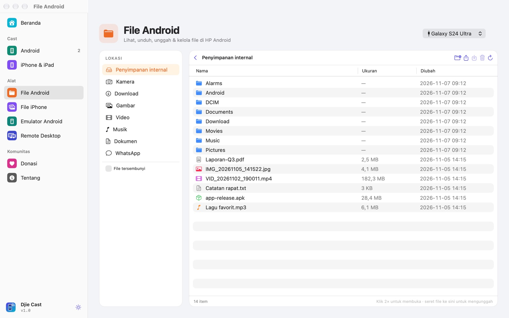
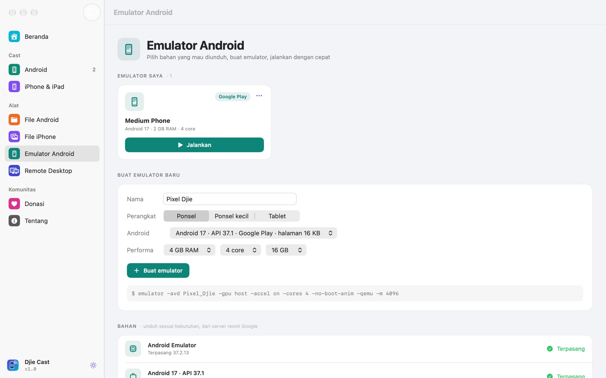
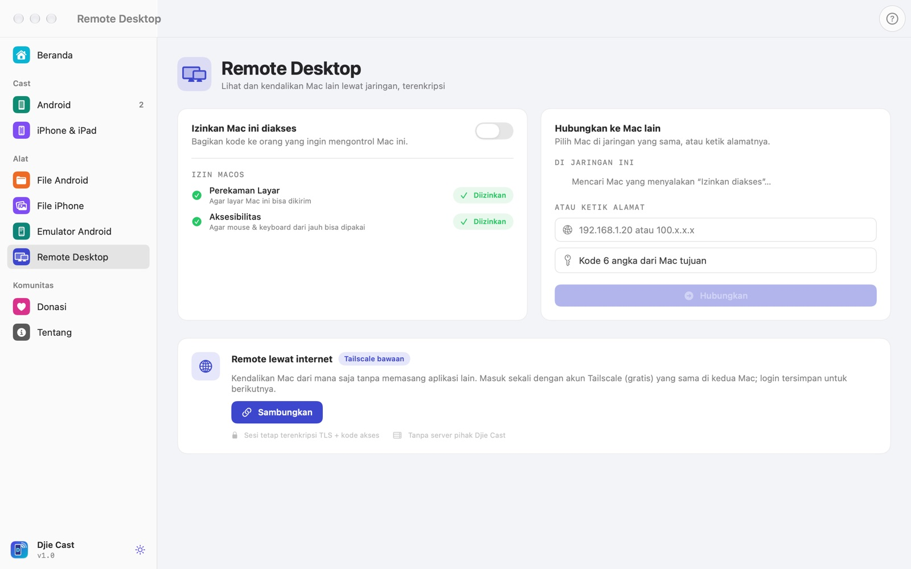
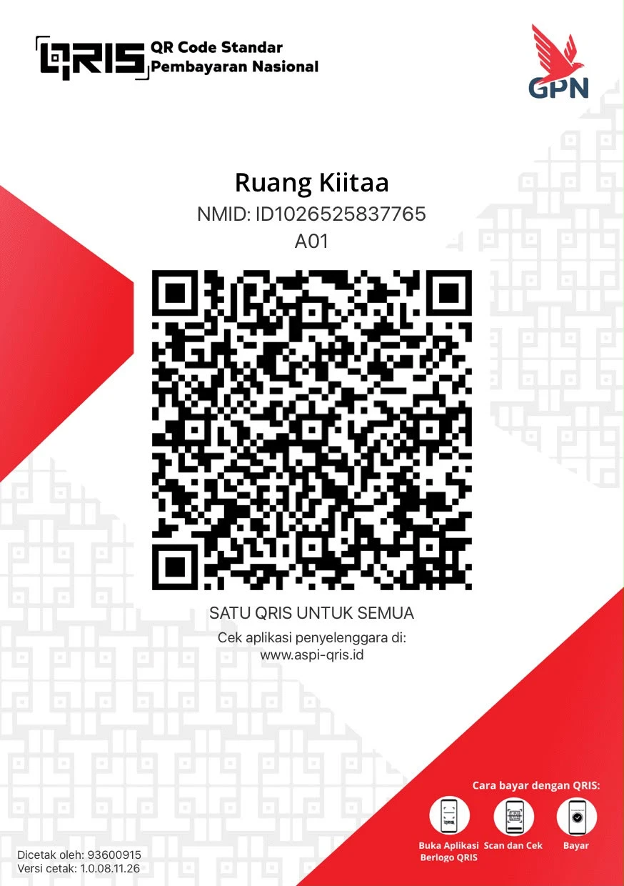

<p align="center">
  
</p>

<h1 align="center">Djie Cast</h1>

<p align="center">
  Your phone's screen, right on your Mac.<br>
  Mirror and control Android, show your iPhone, manage files, run emulators, and control another Mac.<br>
  Free, open source, no terminal.
</p>

<p align="center"><a href="README.md">Bahasa Indonesia</a> · <b>English</b></p>

<p align="center">
  <a href="https://github.com/masadjie/djie-cast/releases/latest"><b>Download for Mac</b></a>
  &nbsp;·&nbsp;
  <a href="https://masadjie.github.io/djie-cast/?lang=en">Website</a>
  &nbsp;·&nbsp;
  <a href="https://masadjie.github.io/djie-cast/#video">30-second video</a>
</p>

<p align="center">
  
  
  
</p>

<picture>
  <source media="(prefers-color-scheme: dark)" srcset="docs/assets/home-dark.jpg">
  
</picture>

Djie Cast started from a habit of running `scrcpy` in the terminal every time I wanted my phone on my Mac. Now you plug in a cable and click one button. Everything runs on your own Mac: no account, no server, no ads. The app speaks English and Indonesian and follows your macOS language (switch it with the 🌐 button in the sidebar).

## Android

<picture>
  <source media="(prefers-color-scheme: dark)" srcset="docs/assets/android-dark.jpg">
  
</picture>

Every connected phone shows up as a full card: a live snapshot of the screen, Android version, chipset, RAM, battery health and cycles, free storage. Press **Start Cast** and the phone opens in a Mac window you can click, scroll and type into.

- USB cable or Wi-Fi. Phones with Wireless debugging on the same network appear by themselves; pair once with the 6-digit code.
- Back, Home, Recents, volume, power, screenshot and rotation buttons.
- **Phone camera**: show the front or back camera on your Mac (Android 12+).
- Installed apps: uninstall, or install an APK from your Mac.
- Quality presets: Saver 1024p, Balanced 1600p, Maximum up to 120 fps. Screen recording to Movies.

Your Mac keyboard becomes a remote: `⌘B` back, `⌘H` home, `⌘S` recent apps, `⌘↑/↓` volume, `⌘R` rotate, `⌘V` paste text.

## iPhone & iPad

<picture>
  <source media="(prefers-color-scheme: dark)" srcset="docs/assets/ios-dark.jpg">
  
</picture>

| Route | What you get | Needs |
|---|---|---|
| USB | Screen + audio | A cable, tap "Trust" on the iPhone |
| iPhone Mirroring | Full control | macOS 15 + iOS 18, same Apple ID |
| AirPlay | Screen | Same Wi-Fi, AirPlay Receiver on |
| Continuity Camera | iPhone camera on Mac | macOS 14 + iOS 17, same Apple ID |

Apple only allows iPhone control through iPhone Mirroring, so Djie Cast opens it from the same page. iPhone info (model, iOS, battery health and cycles, storage) and the app list are read over the cable, or over Wi-Fi for iPhones with Wi-Fi sync on.

## Files

<picture>
  <source media="(prefers-color-scheme: dark)" srcset="docs/assets/files-dark.jpg">
  
</picture>

Android storage opens like Finder: download, drag files in to upload, create folders, rename, delete. For iPhone, the photo and video gallery shows up with thumbnails and downloads in one go.

## Android Emulator

<picture>
  <source media="(prefers-color-scheme: dark)" srcset="docs/assets/emulator-dark.jpg">
  
</picture>

No Android Studio needed. Pick which Android versions to download (straight from Google's servers, checksum-verified), create a phone or tablet emulator, and run it on your Mac's GPU. A running emulator gets the same spec card as a real phone.

## Remote Desktop

<picture>
  <source media="(prefers-color-scheme: dark)" srcset="docs/assets/remote-dark.jpg">
  
</picture>

Control another Mac with a 6-digit code. The connection is TLS-encrypted and the video is hardware H.264. Macs on the same network are found automatically. Over the internet, Tailscale is built in: sign in once and the session is remembered. A Mac being controlled always shows a red panel with a Disconnect button.

## Install

1. Download the DMG from [Releases](https://github.com/masadjie/djie-cast/releases/latest).
2. Drag **Djie Cast** to **Applications**.
3. First launch: right-click → **Open** → **Open** (the app isn't notarized by Apple yet). If macOS says it's *damaged*:

```bash
xattr -dr com.apple.quarantine "/Applications/Djie Cast.app"
```

scrcpy and adb are bundled inside the app.

### Supported Macs

Any Mac that runs macOS 14 Sonoma or later:

| Mac | From |
|---|---|
| MacBook Air | 2018 and later, all M1–M4 |
| MacBook Pro | 2018 and later, all M1–M5 |
| iMac | 2019 and later |
| iMac Pro | 2017 |
| Mac mini | 2018 and later |
| Mac Studio | all |
| Mac Pro | 2019 and later |

iPhone info and apps need an Apple Silicon Mac. iPhone Mirroring needs macOS 15. iPhone camera needs macOS 14 and iOS 17. Everything else runs on Intel and Apple Silicon.

## Build from source

```bash
git clone https://github.com/masadjie/djie-cast.git
cd djie-cast
./build.sh
```

You need the Xcode Command Line Tools and Go (`brew install go`) for libtailscale. The first build downloads the official scrcpy release and checks its SHA-256. Output lands in `build/`. Translations live in `i18n/en.json` (Indonesian source text → English).

## Built on

- [scrcpy](https://github.com/Genymobile/scrcpy) and adb for Android (Apache 2.0)
- [libimobiledevice](https://libimobiledevice.org) for iPhone info and apps (LGPL)
- [libtailscale](https://github.com/tailscale/libtailscale) for Remote Desktop over the internet (BSD)

## Support the project

Djie Cast is free. If it helps your work, you can buy me a coffee through QRIS (Indonesian payment QR) below and let me know on WhatsApp at **+62 812-6949-4591**.

<p align="center"></p>

Bugs, ideas and pull requests are welcome in [Issues](https://github.com/masadjie/djie-cast/issues).

## License

[MIT](LICENSE) © 2026 Adjie Kurniawan.
