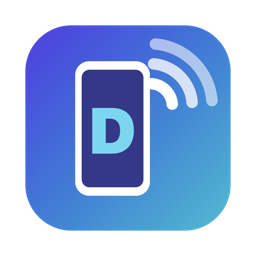
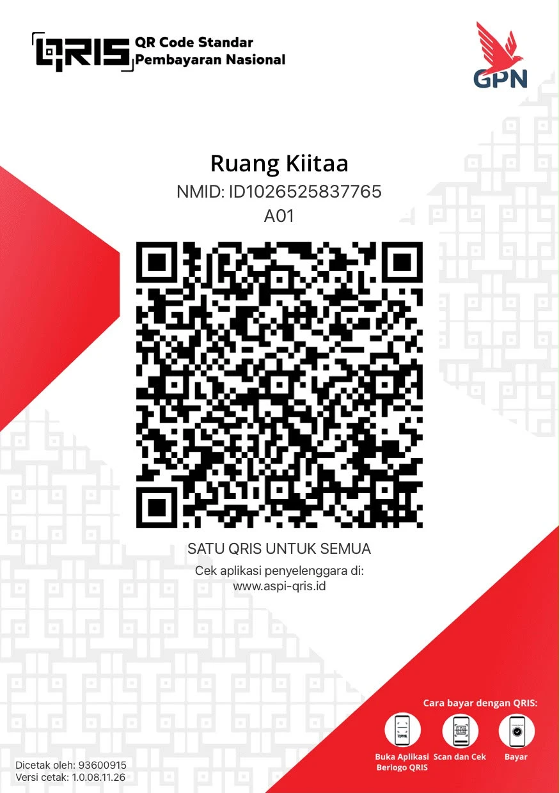

<p align="center">
  
</p>

<h1 align="center">Djie Cast</h1>
<p align="center"><b>Cast Android & iOS ke Mac — cepat, jernih, tanpa ribet.</b><br>
Aplikasi macOS gratis & open source karya <b>Adjie Kurniawan</b>, dibangun di atas <a href="https://github.com/Genymobile/scrcpy">scrcpy</a>.</p>

<p align="center">
  🌐 <a href="https://masadjie.github.io/djie-cast/"><b>masadjie.github.io/djie-cast</b></a>
</p>

<p align="center">
  
  
  
</p>

---

## ✨ Fitur

### Android
- **Mirror + kontrol penuh** — klik, scroll, drag & ketik langsung dari Mac, tanpa menyentuh HP.
- **USB atau Wi-Fi** — aktifkan mode wireless dengan satu klik.
- **Panduan bawaan** — langkah mengaktifkan USB Debugging langsung di aplikasi.
- **Kontrol cepat** — Back, Home, Recent, volume, power & screenshot.
- **Rotasi layar** — paksa HP ke portrait / landscape / otomatis, atau putar tampilan jendela (⌘R, ⌘← / ⌘→).
- **File Android** — jelajahi, unduh, unggah (drag & drop), ganti nama & hapus file di HP.
- **Preset kualitas** — Hemat / Seimbang / Maksimal / Kustom, plus audio, rekam layar, selalu di atas, dll.
- **Tanpa install apa pun** — scrcpy & adb sudah dibundel di dalam app.

### 🖥️ Remote Desktop (Mac ke Mac)
- **Kendalikan Mac lain** seperti AnyDesk: lihat layarnya, gerakkan mouse, ketik, scroll, dan pakai shortcut ⌘.
- **Kode akses 6 angka** + koneksi **terenkripsi TLS**. Kode salah langsung ditolak.
- **Mac terdeteksi otomatis** di jaringan yang sama, atau ketik alamat IP-nya.
- **Beda jaringan**: pakai [Tailscale](https://tailscale.com) (gratis) dan ketik alamat 100.x.x.x.
- Mac yang dikontrol menampilkan panel merah **"Mac ini sedang dikontrol"** dengan tombol Putuskan.
- Butuh izin **Perekaman Layar** dan **Aksesibilitas** di Mac yang dikontrol (ada panduannya di app).

### 🎥 Untuk live streaming
Jendela cast bisa ditangkap software live di Mac seperti **OBS Studio**, **Streamlabs**, **Ecamm Live**, dan **TikTok LIVE Studio** (bila versi Mac tersedia) lewat *Window Capture*. Nyalakan "Tanpa bingkai jendela" untuk gambar yang bersih. HP tetap bisa dikontrol dari Mac selama siaran.

### iPhone & iPad
- **File iPhone** — lihat galeri foto & video iPhone/iPad, unduh ke Mac (satu, beberapa, atau semua).
- **Panduan Trust** — langkah “Percayai Komputer Ini” langsung di aplikasi.
- **USB** — tampilkan layar + audio langsung di Mac (hanya lihat). Jendela mengikuti rotasi iPhone otomatis, bisa diputar manual (⌘← / ⌘→).
- **iPhone Mirroring** — kontrol penuh lewat fitur resmi Apple (macOS Sequoia + iOS 18).
- **AirPlay** — mirror wireless.

> Apple tidak mengizinkan aplikasi pihak ketiga mengontrol iPhone lewat USB/AirPlay, jadi kontrol iOS hanya tersedia lewat iPhone Mirroring.

## 📥 Install

1. Unduh file DMG terbaru dari halaman [**Releases**](https://github.com/masadjie/djie-cast/releases).
2. Seret **Djie Cast** ke folder **Applications**.
3. Pembukaan pertama: **klik kanan → Open → Open** (app belum dinotarisasi Apple).
   Jika muncul pesan *"damaged"*:
   ```bash
   xattr -dr com.apple.quarantine "/Applications/Djie Cast.app"
   ```

**Syarat:** macOS 14 (Sonoma) atau lebih baru — Apple Silicon & Intel.

## 🛠 Build dari source

Butuh Xcode Command Line Tools (`xcode-select --install`).

```bash
git clone https://github.com/masadjie/djie-cast.git
cd djie-cast
./build.sh
```

Hasil: `build/Djie Cast.app` dan file DMG di folder `build/`.
Saat build pertama, `scripts/fetch-scrcpy.sh` otomatis mengunduh scrcpy resmi dan memverifikasi checksum SHA-256-nya.

### Struktur
| File | Isi |
|---|---|
| `Sources/DjieCastApp.swift` | App, splash, sidebar, Beranda |
| `Sources/AndroidCast.swift` | Cast Android, kontrol, pengaturan |
| `Sources/AndroidFiles.swift` | File manager Android |
| `Sources/IOSCast.swift` | Cast iPhone/iPad |
| `Sources/Remote*.swift` | Remote Desktop: protokol, host, viewer, halaman |
| `Sources/Donate.swift` | Halaman donasi |
| `Sources/About.swift` | Halaman Tentang |
| `Sources/UI.swift` | Komponen UI bersama |
| `make_icon.swift` | Generator ikon app |

## 🤝 Kontribusi

Pull request, laporan bug, dan ide fitur sangat diterima! Buka *Issue* atau kirim *PR*.

## ❤️ Donasi

Djie Cast gratis selamanya. Kalau aplikasi ini membantu, kamu bisa traktir kopi lewat QRIS:

<p align="center"></p>

Scan dengan aplikasi bank / e-wallet apa pun yang mendukung QRIS (GoPay, OVO, DANA, ShopeePay, m-banking, dll).

Setelah donasi, mohon konfirmasi ke **0812-6949-4591** (WhatsApp). Terima kasih! 🙏

## 📄 Lisensi

[MIT](LICENSE) © 2026 **Adjie Kurniawan**.
scrcpy & adb dilisensikan di bawah Apache License 2.0.
